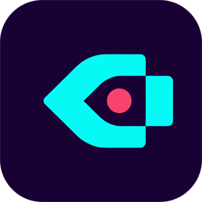

# Clipsy

Leichtgewichtiger Game-Clipper für Windows 10/11. Läuft unsichtbar im Hintergrund und speichert
auf Tastendruck die letzten Sekunden als MP4.

## Funktionen

- **F10** speichert einen Clip (Standard: letzte 30 Sekunden, 1080p60)
- **Ohne Overlays:** nimmt direkt das Spielfenster auf (Windows Graphics Capture), nicht den Bildschirm –
  Fenster darüber (Discord-Overlay, Benachrichtigungen, Clipsys Status-Punkt …) landen nicht im Clip
- **Status-Logo:** Clipsy-Logo mit Punkt – grün = Clippen an, rot = pausiert, orange = startet. Nie in Aufnahmen sichtbar
- **Clip-Meldung:** gleitet nach dem Speichern von rechts herein (oben rechts oder unten rechts über der Taskleiste)
- **Abspiel-Hinweis:** fehlt Windows die AV1- bzw. HEVC-Erweiterung für die Medienwiedergabe, weist Clipsy darauf hin
  und öffnet auf Klick den Microsoft Store
- **Zahnrad öffnen:** Doppelklick aufs Tray-Icon – oder `Clipsy.exe` einfach nochmal starten
- **Immer an:** startet mit Windows und ist nach jedem Neustart automatisch wieder aktiv –
  auch wenn man es vorher deaktiviert hat
- **⚙ Einstellungen** (Tray-Icon → Doppelklick): Qualität 720p / 1080p, 30 / 60 FPS,
  Clip-Länge (15 s bis 5 Min), Tasten ändern, Speicherort, Status-Punkt, Autostart
- **Audiogeräte:** Spiel-Sound und Mikrofon wählbar – „Automatisch“ bevorzugt USB-Geräte (Headset, USB-Mikro),
  sonst Windows-Standard; Ein-/Ausstecken wird erkannt. Mikrofon ist standardmäßig aus.
- **Clip-Ordner öffnen** direkt aus Tray-Menü oder Einstellungen
- Hardware-Encoding automatisch (NVIDIA NVENC → AMD AMF → Intel QSV → CPU), qualitätsbasiert.
  Format „Automatisch“: **AV1**, wenn die Grafikkarte es kann (RTX 40/50, RX 7000/9000, Intel Arc),
  sonst **HEVC** (30-s-Clip 1080p60 ≈ 22 MB statt 71 MB, ohne sichtbaren Unterschied), sonst H.264
- **Nachkomprimieren (optional):** Clips werden im Hintergrund zu AV1 umgerechnet (≈ 60 % kleiner),
  nur wenn kein Spiel läuft, mit niedrigster Priorität. Original wird erst ersetzt, wenn AV1 fertig und kleiner ist.

## Installation

1. Unter **Releases** `Clipsy-win64.zip` herunterladen
2. Entpacken, z. B. nach `C:\Programme\Clipsy` oder `%LOCALAPPDATA%\Clipsy-App`
3. `Clipsy.exe` starten – fertig (Autostart richtet sich selbst ein)

Clips landen standardmäßig in `Videos\Clipsy`.

## Tasten (Standard)

| Taste | Aktion |
|---|---|
| `F10` | Clip speichern |
| `Ctrl+Shift+F10` | Clippen an/aus |

## Wichtig zu Overlays

- **Separate Overlay-Fenster** (aktuelles Discord-Overlay, Xbox Game Bar, Benachrichtigungen) → werden ignoriert.
- **In-Game-Overlays, die direkt ins Spielbild gezeichnet werden** (z. B. Steam-Overlay, ältere Overlays,
  FPS-Zähler von Afterburner/RTSS) sind Teil des Spielbilds. Die lassen sich ohne DLL-Injection nicht
  herausfiltern – und Injection riskiert Anti-Cheat-Banns. Diese Overlays daher im jeweiligen Programm abschalten.
- Spiele im **exklusiven Vollbild** zeigen den Status-Punkt evtl. nicht an (das Clippen funktioniert trotzdem).
  Empfehlung: „Randloses Fenster“ / „Borderless“ im Spiel nutzen.
- Wird ein Spiel nicht als Vollbild erkannt (z. B. kleines Fenster), nimmt Clipsy den Bildschirm auf.

## Technik

- .NET 10 WinForms (Tray-App), ffmpeg (`gfxcapture` + Hardware-Encoder) als Aufnahme-Engine
- Ringpuffer aus 2-s-Segmenten in `%LOCALAPPDATA%\Clipsy\buffer`, Clip = verlustfreies Zusammenfügen
- Spiel-Sound per WASAPI-Loopback (NAudio)
- Einstellungen: `%APPDATA%\Clipsy\settings.json`, Log: `%LOCALAPPDATA%\Clipsy\clipsy.log`

## Bauen

Wird automatisch über GitHub Actions gebaut (`.github/workflows/build.yml`). Lokal:

```
dotnet test tests/Clipsy.Tests/Clipsy.Tests.csproj
dotnet publish src/Clipsy/Clipsy.csproj -c Release -r win-x64 --self-contained true -p:PublishSingleFile=true -o out/Clipsy
```

Danach `ffmpeg.exe` (Build mit `gfxcapture`, z. B. BtbN „master“) nach `out/Clipsy/ffmpeg/` legen.

## Lizenz

MIT. Das gebündelte ffmpeg steht unter GPL (Lizenz liegt im Ordner `ffmpeg/`).
